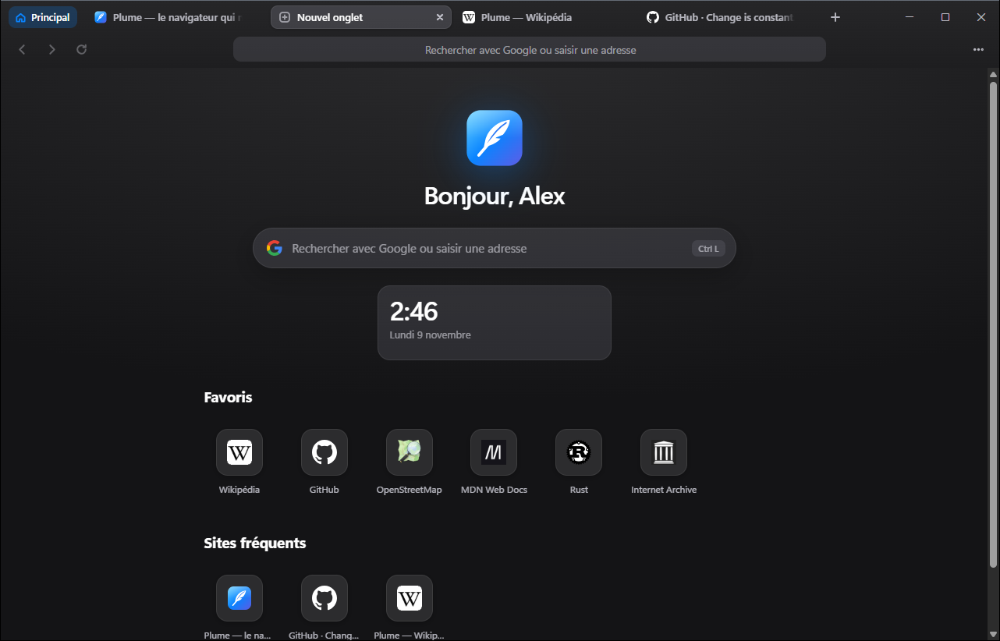
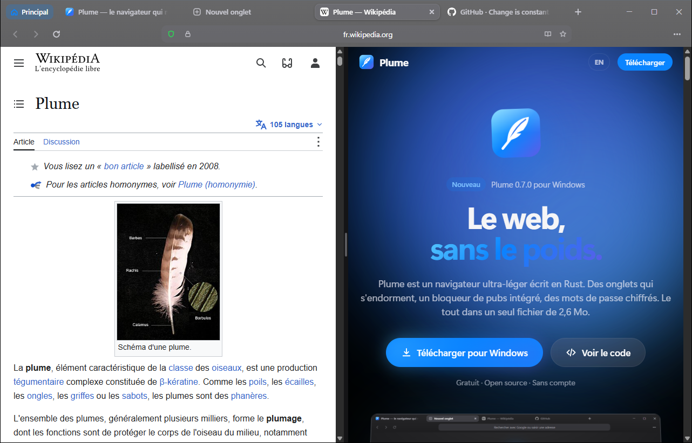
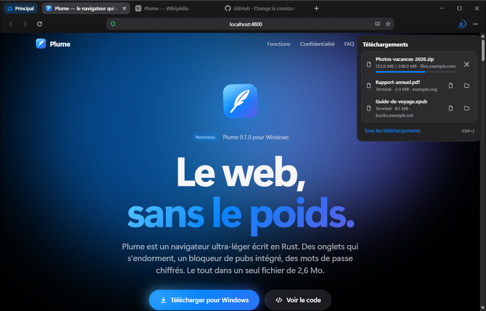

<p align="center">
  
</p>

<h1 align="center">Plume</h1>

<p align="center">
  <b>The browser that weighs nothing.</b><br>
  An ultra-light web browser for Windows, written in Rust — one ~2.6 MB file.<br>
  <i>Le navigateur qui ne pèse rien — ultra-léger, écrit en Rust, un installeur de 2,6 Mo.</i>
</p>

<p align="center">
  <a href="https://github.com/shxmacrypto/plume/releases/latest/download/PlumeSetup.exe"><b>⬇ Download PlumeSetup.exe</b></a>
  ·
  <a href="https://github.com/shxmacrypto/plume/releases">All releases</a>
  ·
  <a href="CHANGELOG.md">Changelog</a>
</p>

<p align="center">
  
</p>

---

> **The Plume suite (work in progress, on the `suite` branch).** Plume is growing into three small native apps
> with one look: Plume Web (this browser), [Plume FEx](apps/fex) (a file explorer with instant search) and
> [Plume Mail](apps/mail). The plan and the state of the work are in [docs/suite/PLAN.md](docs/suite/PLAN.md).

## Features

- **Tiny** — a ~2.6 MB installer, no admin rights needed. It renders pages with the WebView2 (Microsoft Edge) engine already on Windows, so it ships no browser engine of its own.
- **Memory saver** — background tabs are suspended, then unloaded after a few minutes (unless they play audio). Restored tabs sleep until you open them.
- **Ad & tracker blocker** — ~3,600 domains plus cosmetic filters, a per-site toggle and Edge tracking prevention.
- **Encrypted passwords** — a vault locked by one master password (Argon2id + AES-256-GCM). Plume offers to save logins, fills them for you and imports CSV exports.
- **Import** — history, favorites and their icons from Chrome, Edge, Brave, Opera, Opera GX, Vivaldi and Firefox.
- **Chrome extensions** — install from the Chrome Web Store, pin them in the toolbar, open them as floating popups or in a side panel.
- **Tabs your way** — groups, pinned tabs, vertical tabs, multiple windows, InPrivate windows, drag to reorder.
- **Reading** — reader mode, read aloud, page translation, dark mode per site.
- **Video & audio download** — MP4, WEBM, MKV, MP3, WAV, FLAC… via yt-dlp + FFmpeg, installed on demand.
- **Plume DevTools** — a docked panel with console, elements, network, storage and performance.
- **Updates in one click** — Plume checks GitHub each time it starts (or right away with *Settings › About › Check now*), then downloads, verifies (SHA-256) and installs new versions itself. If GitHub is slow or down, it says so instead of hanging.
- **For everyone** — French & English, light/dark themes, text size, high contrast, reduced motion, full keyboard support.

And much more, each feature optional and free when switched off:

- **Tabs** — workspaces, split screen, tab search, Peek previews, sessions, notes, archive of inactive tabs.
- **Navigation** — command palette (`Ctrl+K`), calculator and unit conversions in the address bar, Tab to search a site (YouTube, Wikipedia, Amazon…), mouse gestures.
- **Privacy** — containers (two accounts at once), clear data on close, a privacy report under the shield, password generator and audit, breach check, Windows Hello, secure DNS.
- **Appearance** — adaptive tint, new tab backgrounds and widgets (clock, weather, to-do), custom CSS/JS per site, compact and Zen modes, full screen.
- **Tools** — automatic picture-in-picture, media control, focus mode with Pomodoro, color picker and ruler, QR code, save as PDF or Markdown, read later offline.
- **Performance** — memory badge and task manager (`Shift+Esc`), battery saver, never-sleep list, smart preloading, Lite mode per site, statistics.
- **Downloads** — choose where to save each file, a downloads bubble with progress, *Open* and *Show in folder*, and downloads that keep going when you close their tab.
- **Default browser** — make Plume your default browser from the welcome setup or Settings; links and `.html` files from other apps then open in a new tab of your open Plume window.

<p align="center">
  
  
</p>

## Install

1. Download [`PlumeSetup.exe`](https://github.com/shxmacrypto/plume/releases/latest/download/PlumeSetup.exe) and run it. Plume installs for your account in `%LOCALAPPDATA%\Programs\Plume` (no admin rights), adds Start menu and desktop shortcuts, and opens.
2. Windows SmartScreen may warn about an *unknown publisher* because the installer is not code-signed: click **More info → Run anyway**. Each release ships a `PlumeSetup.exe.sha256` file so you can check the download.
3. Windows Security may also block the installer or Plume the first time and call it a threat. It's a false positive: Microsoft's automatic scan flags new programs that aren't code-signed yet. Open **Windows Security → Virus & threat protection → Protection history**, select the Plume entry, choose **Actions → Allow on device**, then run the installer again. You only need to do this once.

Silent install: `PlumeSetup.exe --quiet` (add `--no-desktop` to skip the desktop shortcut).

Requires Windows 10 or 11 (64-bit) with the **WebView2 Runtime**, which is preinstalled on Windows 11 and on up-to-date Windows 10.

**Updates:** when a new version is out, Plume shows a bar under the address bar. *Install update* downloads `PlumeSetup.exe` from this repository's releases, checks it against the SHA-256 that GitHub publishes, and installs it; *Restart now* finishes the job and reopens your tabs. If GitHub is slow or unreachable, the bar says so and offers *Try again* and *Download from GitHub*.

**Uninstall:** Windows Settings › Apps › Plume. You choose whether to keep your data (`%LOCALAPPDATA%\Plume`).

## Privacy

Plume has no account and no telemetry. Your history, favorites and settings stay in `%LOCALAPPDATA%\Plume`, and passwords are encrypted there. Plume itself only goes online when you ask it to, plus:

| Request | When | Can be turned off |
|---|---|---|
| `github.com` — where the latest release page points (its version number) | each time Plume starts | Settings › About › Check for updates automatically |
| `api.github.com` and `github.com` — the new installer and its SHA-256 | when you click *Install update* | — |
| Chrome Web Store download | when you install an extension | — |
| yt-dlp (GitHub) and FFmpeg (gyan.dev) | the first time you download a video, after you agree | — |
| `api.frankfurter.app` — currency rates | when you convert a currency in the address bar, at most once a day | Settings › Navigation › Currencies |
| `api.pwnedpasswords.com` — first 5 characters of a SHA-1 hash | only if you turn on the data breach check | off by default |
| your secure DNS provider | every site address lookup, only if you turn on secure DNS | off by default |
| `bing.com` — picture of the day | once a day, only if you choose it as new tab background | off by default |
| `open-meteo.com` — weather | only with the weather widget and a city you enter | off by default |

Pages are rendered by Microsoft's WebView2 runtime; Plume starts it with Edge's background services, sync and crash reporting disabled.

## Build from source

Plume builds with the **GNU** Rust toolchain, so Visual Studio is not needed.

1. Install Rust and the GNU toolchain:
   ```powershell
   rustup toolchain install stable-x86_64-pc-windows-gnu
   rustup default stable-x86_64-pc-windows-gnu
   ```
2. Get GNU **binutils** from MSYS2's `mingw-w64-x86_64-binutils` package: `dlltool.exe`, `windres.exe`, `as.exe` and their DLLs (`libintl-8.dll`, `libiconv-2.dll`, `zlib1.dll`, `libzstd.dll`). Put them in `%USERPROFILE%\.mingw-binutils`, or anywhere else and point `PLUME_BINUTILS` at that folder.
3. Build:
   ```powershell
   .\build.ps1
   ```
   The result is the installer `dist\PlumeSetup.exe` plus `dist\PlumeSetup.exe.sha256`.

Run the tests with `cargo test --release` (Rust) and `node --test tests/ui07.test.js` (interface functions: calculator, fuzzy search, QR codes). Tests that need the network are marked `#[ignore]`.

Before a commit, these two commands must have nothing left to say (`rustup component add clippy rustfmt` installs them):

```powershell
cargo fmt --all
cargo clippy --workspace --all-targets
```

The code style is set in `rustfmt.toml` (lines up to 160 columns). `vendor/wry` is left out of both.

`vendor/wry` is a copy of wry 0.53.5 with two small changes: the WebView2 profile name used by containers, and page messages from addresses that `http::Uri` can't parse (such as local `file:///` pages) no longer crash Plume (see `vendor/wry/PLUME.md`). `Cargo.toml` points to it with `[patch.crates-io]`.

## Publish a new version

```powershell
.\release.ps1 0.7.1            # bump the version, build, commit, tag, push and publish the release
.\release.ps1 0.7.1 -DryRun    # preview, change nothing
```

1. Describe the changes under a `## 0.7.1 - YYYY-MM-DD` heading in [`CHANGELOG.md`](CHANGELOG.md), and the same in French in [`CHANGELOG.fr.md`](CHANGELOG.fr.md). The English text becomes the GitHub release notes; both are shown on the website's *Release notes* page (`site-notes.ps1`, run by the script, copies them there).
2. Run the script. It publishes with the [GitHub CLI](https://cli.github.com/) (`gh`) if it is installed. Otherwise it opens the prefilled release page and the `dist` folder, and you drop in the two files. When the notes are too long for the page address, the script copies them to the clipboard instead: paste them into the description.
3. The download link `releases/latest/download/PlumeSetup.exe` always points to the newest release. The script also writes the new version into the website's `js/config.js` (`..\..\PlumeSite`); refresh the site's *What's new* section, its screenshots and this README (`docs/screens`), then push the site.
4. Installed copies of Plume see the new version within a day (right away with *Settings › About › Check now*) and install it in one click.

The version number has a single source: `version` in `Cargo.toml`.

## Project layout

```
src/main.rs        windows, tabs, events (Rust, wry + tao + WebView2)
src/settings.json  every setting: default per mode, section, network use; read by settings.rs and the interface
src/settings.rs    defaults, migration of older profiles, mode switch, resets
src/perf.rs        process memory / CPU, battery, metered connection
src/tabs07.rs      workspaces, archive, split screen, Peek, sessions, notes, custom shortcuts
src/feats07.rs     command palette and mouse gestures messages
src/priv07.rs      containers, clear on close, privacy report, password audit, Windows Hello, secure DNS
src/pwgen.rs       password generator, audit, breach check (k-anonymity)   src/hello.rs  Windows Hello
src/look07.rs      Zen and full screen, adaptive tint, new tab images and widgets, custom CSS/JS
src/tools07.rs     picture-in-picture, media control, focus mode, color picker, PDF/Markdown, read later
src/ui/            the browser interface: style.css, style07.css, body.html, i18n.js, i18n07.js, app.js, settings.js,
                   feat_*.js (one file per theme), pure07.js (calculator, fuzzy search, QR codes), devtools.js, boot.js
src/page.js        script injected into web pages: password autofill, reader mode, dark mode, read aloud and the 0.7 page features
tests/             tests of the interface functions (node --test)
vendor/wry/        wry 0.53.5 with WebView2 profiles (containers)
src/vault.rs       encrypted password vault
src/import.rs      Chromium / Firefox profile import (sqlite.rs reads their databases with Windows' winsqlite3.dll)
src/ext.rs         Chrome Web Store download + CRX/ZIP unpacking        src/bicon.rs  real browser icons
src/adblock.rs     blocker (assets/adlist.txt)                          src/media.rs  yt-dlp / FFmpeg downloads
src/devtools.rs    bridge to the Chrome DevTools Protocol for Plume DevTools
src/setup.rs       installed Plume: shortcuts, Settings › Apps entry, uninstall
src/defbrowser.rs  default browser: Windows registration, links handed to the Plume window already open
src/update.rs      in-app updates: GitHub release, download, SHA-256 check
launcher/          PlumeSetup.exe: embeds plume.exe + WebView2Loader.dll and installs them
assets/            logo, icon, ad list
```

## Credits

Built with [wry](https://github.com/tauri-apps/wry) and [tao](https://github.com/tauri-apps/tao) (Tauri), [webview2-com](https://github.com/wravery/webview2-rs), [windows-rs](https://github.com/microsoft/windows-rs), [serde_json](https://github.com/serde-rs/json), [RustCrypto](https://github.com/RustCrypto) `aes-gcm`, `argon2`, `sha1` and `sha2`, and [miniz_oxide](https://github.com/Frommi/miniz_oxide).

- QR codes follow the ISO/IEC 18004 algorithm as described by Project Nayuki's reference implementation.
- Optional online services: [Have I Been Pwned](https://haveibeenpwned.com/Passwords) (Pwned Passwords), [Frankfurter](https://www.frankfurter.app/) (exchange rates), [Open-Meteo](https://open-meteo.com/) (weather), Bing (picture of the day).

- The ad list in `assets/adlist.txt` is based on [Peter Lowe's ad server list](https://pgl.yoyo.org/adservers/); see that site for its terms of use.
- `WebView2Loader.dll` is redistributed from Microsoft's WebView2 SDK.
- yt-dlp and FFmpeg are not bundled. They are downloaded from their official sources only when you use video download, and keep their own licenses.

## License

[MIT](LICENSE)
