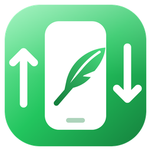

<p align="center"></p>

<h1 align="center">Plume Drop</h1>

<p align="center"><b>Send files between this PC and your phone.</b> Scan a QR code, and you're connected.</p>

Plume Drop shows a **QR code**. Scan it with a phone's camera: the phone opens a page served by this PC, and the two can
exchange **files, photos, text and links**. The phone needs no app and no account. It only needs to be on the same Wi-Fi.

- **From the phone**: *Send photos and files* (several at once, with progress). They land in `Downloads\Plume Drop`
  (you can change it in Settings). Text goes to the PC's clipboard. A link can open in the browser if you turn that on.
- **From the PC**: drop files on the window, or use *Send files…*, *Send text…*, Ctrl+V on files copied in Explorer,
  or `plume-drop.exe file…`. Connected phones see them under *From the PC* and can save them. Pictures show a preview.
- **Devices**: the window lists connected phones. A new device needs **your OK the first time**; after that it is
  remembered. *Disconnect* ends its access, and the phone has to ask again.
- **History**: what came in and what went out, with *Open*, *Show in folder* and *Copy*.
- **Another computer** works too: open the link (*Copy link*) in any browser on the same network and drop files on
  the page.

The first time, Windows Firewall may ask whether Plume Drop can use the network. Allow it on **private** networks.

## What goes online

Nothing. Plume Drop runs a small web server on this PC (port 53917, or one of the next ten if that one is taken).
The phone talks to it directly over your Wi-Fi. There is no relay, no account and no cloud. Plume Drop makes no
internet request of its own.

## Security

- The QR code holds a **random code** (22 characters, about 131 bits) after `#` in the address. Browsers never send
  that part to a server. The page keeps the code on the phone and sends it with **every request**. The PC compares it
  in constant time. The page itself (HTML, script, style, icon) holds nothing secret and is served without it.
- A device seen for the first time **waits for your OK**. Devices you allow are remembered in `devices.json`
  (a random ID made by the page, never a name).
- *New code* changes the code: every phone has to scan again.
- After 30 wrong codes in 10 minutes, an address is refused for a while. Each wrong code also waits 300 ms.
- Names sent by a phone are cleaned before saving: no folders (`..\`), no characters Windows refuses, no reserved
  names (`CON`, `COM1`…). A name already taken becomes `name (2).ext`.
- Files are streamed to and from the disk in 64 KB pieces, never held whole in memory. A transfer that stops halfway
  leaves nothing behind.
- The page has a strict Content-Security-Policy (no inline script, nothing from other sites). Answers are never cached.

The link is plain HTTP: on your own Wi-Fi this is fine, but on a shared network (a café, a hotel), someone else on it
could see what you send. Use it on networks you trust.

## Files

`%LOCALAPPDATA%\Plume\Drop\`: `settings.json` (folder, options, the code, the port), `devices.json` (allowed
devices), `history.json` (the last 300 transfers).

## Code

| File | What it does |
| --- | --- |
| `main.rs` | window, single instance (a second launch hands over its files), files dropped on the window |
| `hub.rs` | the server: the code, devices and their OK, long polling, uploads, downloads |
| `http.rs` | a small HTTP/1.1 reader and writer (one request per connection, limited headers) |
| `net.rs` | this PC's address on the local network (from the network adapters, no packet sent) |
| `web/` | the phone page (HTML, CSS, JS), built into the exe |
| `ui/` | the window: QR code, sending, devices, history, settings, the "wants to connect" question |
| `settings.rs`, `i18n.rs`, `util.rs` | settings and history, English and French, names, sizes, the code |
| `test_hook.rs` | the test socket (feature `test-hook` only) |

## Tests

```bash
cargo test -p plume-drop
```

Unit tests: safe names, unique names, the code and its comparison, HTTP parsing (and refusing what is not HTTP),
devices (first OK, remembered, refused, disconnected, only the page's hello asks), the lock after wrong codes, the
network address choice.

End to end, a test build is driven through its test socket while a script plays the phone over HTTP:

| Variable | Use |
| --- | --- |
| `PLUME_DROP_DIR` | data folder (settings, devices, history) instead of `%LOCALAPPDATA%\Plume\Drop` |
| `PLUME_DROP_TEST_PORT` | test socket on 127.0.0.1 (feature `test-hook`) |
| `PLUME_DROP_BIND` | address the server listens on, e.g. `127.0.0.1`: no firewall question in tests (`test-hook`) |
| `PLUME_DROP_PORT` | server port (`test-hook`) |
| `PLUME_DROP_TOKEN` | a fixed code (`test-hook`) |
| `PLUME_DROP_NOACTIVATE` | the window opens without taking the focus |
| `PLUME_TEST_FILES` | what *Send files…* "picks" in a test build (plume-ui) |
| `PLUME_SUITE_LANG`, `PLUME_SUITE_THEME` | language and theme |

The script covered: page and CSP, wrong or missing code, unknown device, the OK, a new device waiting, long polling,
offers, downloads (exact bytes, accented name, picture preview), uploads (same name twice, `..\` in a name, `CON`,
no length, a 300 MB upload with steady memory, a cut upload cleaned up), text and links, text sent from the PC,
refusing a device, saves counted in the history, stopping an offer, settings and French, disconnecting and asking
again, a new code, the lock after wrong codes, the history on disk.
